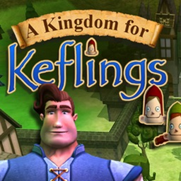

<h1 align=center>A Kingdom for Keflings: Nintendo Switch port</h1>

<b>keflings-nx 1.0.1</b> · <a href="https://chanseyisthebest.github.io/keflings-nx-installer/">web installer</a> · <a href="https://github.com/ChanseyIsTheBest/keflings-nx/releases/tag/v1.0.1">release</a>

An unofficial native port of the Xbox 360 (Xbox Live Arcade) version of **A Kingdom for Keflings** (title `584108DB`),
made by static recompilation with [ReXGlue](https://github.com/rexglue/rexglue-sdk) and drawn by Renut's renderer
([reNut](https://github.com/masterspike52/reNut) by masterspike52) on deko3d. No emulator.

This repository contains no game files. You need your own copy of the game: its Xbox Live Arcade package
(`Content/0000000000000000/584108DB/000D0000/`), title update 2 (`000B0000/`, or the `TU_...` file of the console's
`Cache` folder) and, if you have them, the Kingdom Pack packages (`00000002/`).

## Playing it on the Switch

1. Open the web installer: **https://chanseyisthebest.github.io/keflings-nx-installer/**
   ([its source](https://github.com/ChanseyIsTheBest/keflings-nx-installer)).
2. Give it your packages. It makes the shaders in your browser; nothing is uploaded.
3. Extract the zip to the root of your SD card and start `switch/keflings-nx/keflings-nx.nro` from the Homebrew Menu
   with a title takeover (hold R while starting a game).

Features:

- Title update 2 (Choose your Kingdom, the Kingdom Pack kingdoms) and the Kingdom Packs, installed from `dlc/`.
- 1280x720 handheld, 1920x1080 docked, 60 fps frame limiter; 2x MSAA as in the game (`keflings_renut_msaa_samples`:
  1 = none, 4 = 4x).
- Face buttons by position as on an Xbox pad (`input_xbox_layout = false` for by letter); single Joy-Cons held
  sideways, one per player; button mapping in `[input_p1]`.
- The game's language follows the Switch's, or set `keflings_language` (en, ja, de, fr, es, it, ko or zh).
- The Achievement dialog shows a Switch user's profile picture (`keflings_user_picture`, `keflings_user_picture_user`).
- Profile-guided, link-time-optimised build. No logging.

Your options are in `switch/keflings-nx/renut.toml`, written at the first start; everything else is built into the NRO
(`app/keflings_switch_defaults.toml`).

Known issue:

- Title update 2's avatar giant is left out (no avatar data).

## Building

Both builds need the code generated from your own `default.xex`, which is not in this repository.

1. Generate the code: ReXGlue's codegen with `app/config/`, then `tools/post_codegen.py`.
2. Switch: `tools/build_switch.bat` (devkitA64); release build with PGO + LTO: `tools/build_switch_pgo.bat`.
3. PC: `tools/build_pc.bat` (reNut's renderer on Vulkan).

Notes in `docs/`.

## Credits and license

- [ReXGlue](https://github.com/rexglue/rexglue-sdk) (the recompiler and runtime).
- reNut's renderer by masterspike52 (its author permits its reuse in these ports), through banjo-nx (this port's base).
- sa2-nx, nights-nx, peggle2-nx, bejeweledblitz-nx and the bejeweled3-nx / zuma ports (the built-in settings, the
  language setting, the controls, the gamer pictures, the frame pacing, the exit fix), NetherSX2_nx and battd_nx.
- kameo-nx and the Torchlight port (game memory and the NRO's code on 2 MB blocks).

GPL-3.0 where the sources are ([LICENSE](LICENSE)). A Kingdom for Keflings is NinjaBee's; this project is not
affiliated with NinjaBee or Microsoft.
